# Credit workflow

## Lifecycle

```mermaid
stateDiagram-v2
    [*] --> PENDING: Learner requests future session
    PENDING --> ACCEPTED: Teacher accepts; reserve credits
    PENDING --> DECLINED: Teacher declines
    PENDING --> CANCELLED: Participant cancels
    ACCEPTED --> CANCELLED: Cancel before start; release reservation
    ACCEPTED --> DISPUTED: Report issue after start; void confirmations
    ACCEPTED --> COMPLETED: Both confirm after end; settle once
    DISPUTED --> COMPLETED: Both affirm again after end; settle once
```

Repeated confirmation by the same participant is idempotent. A completed session remains completed. Unrelated users cannot read a session or change its state. Accepting an expired or deactivated-skill request is rejected.

## Acceptance

1. Lock the session and validate provider identity, pending state, active skill, and future start.
2. Lock both wallets in ascending user ID order.
3. Ensure `learner.balance - learner.reserved >= duration / 60`.
4. Check accepted/disputed sessions for either participant. Intervals overlap when `other.start < this.end` and `other.end > this.start`; adjacent intervals are allowed.
5. Increase the learner's reserved balance and mark accepted, within one transaction.

## Completion

1. Lock the session; validate participant, eligible state, and scheduled end time.
2. Record one valid confirmation per participant (or re-affirm a voided confirmation).
3. With only one valid confirmation, commit that confirmation and leave balances unchanged.
4. With two confirmations, lock both wallets in ascending user ID order.
5. Check the reservation and balance; debit the learner, release the reservation, and credit the provider.
6. Insert the unique session transaction; mark completed.
7. Commit all changes together. A failure rolls back even the second confirmation.

For a 90-minute lesson, the exact transfer is 1.50 credits. With 3.00 credits each initially, the teacher ends at 4.50 and the learner at 1.50. Total supply remains 6.00. Starter grants create supply once per registered account; normal transfers conserve it.

## Disputes and cancellation

Before an accepted session starts, either participant can cancel, releasing reserved credits. After the start, participants can report a no-show or disagreement. This moves the session to DISPUTED and voids previous confirmation agreement. The same unique confirmation rows can later be reaffirmed, and settlement requires both participants' valid agreement.

Funds remain reserved while unresolved. There is no automatic expiration, no-show charge, or administrative refund endpoint. An unresolved dispute or a need to cancel/refund after the start requires a future arbitration/refund policy; no participant can force a credit transfer or unilaterally refund a started session in this version.
